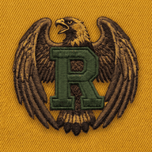
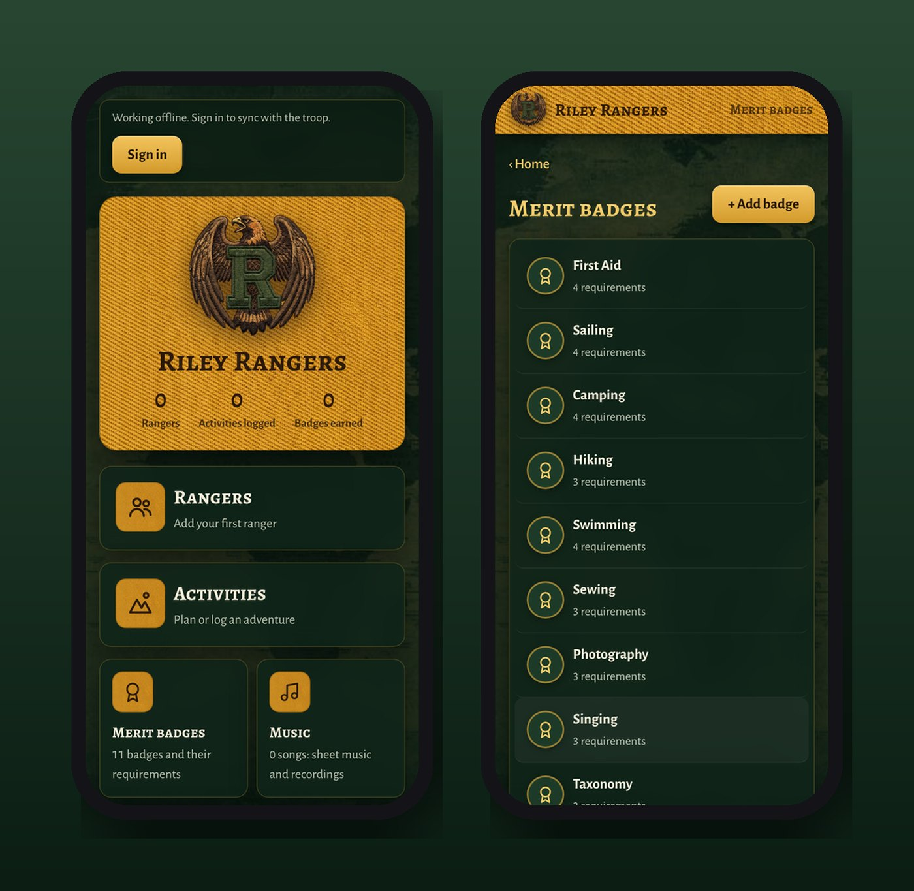
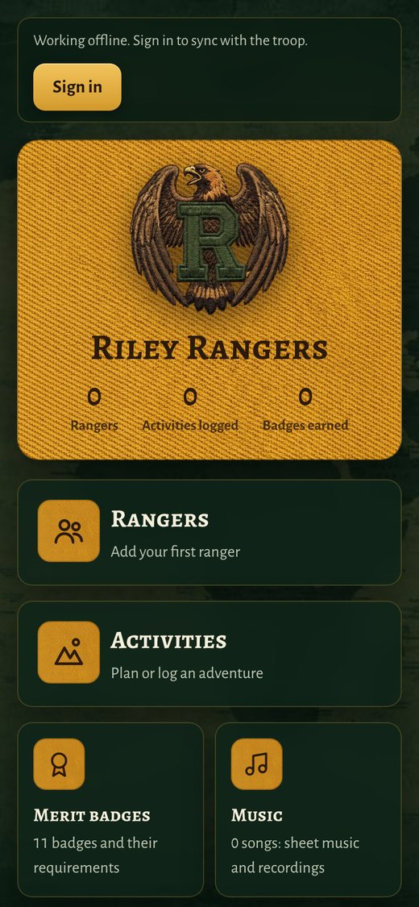
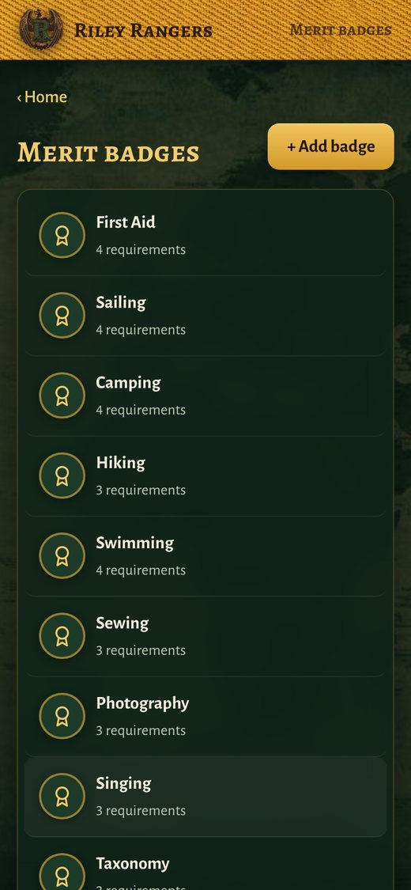

<h1 align="center">Riley Rangers</h1>

<em>The troop's handbook, roster and badge book, in one app.</em>

<a href="https://joshp523.github.io/Rangers-app/"><b>▶ Open the app</b></a>

Riley Rangers is the home base for the family troop, under the watchful eye of the Riley Raptor. It keeps track of every ranger, every adventure and every badge earned.

## What's inside

- **Rangers:** a roster with profile photos and the badges each ranger has earned.
- **Activities:** log hikes, campouts and meetings, with meeting minutes.
- **Merit badges:** each badge and its requirements (First Aid, Sailing, Camping, Hiking, Photography and more), and you can add your own.
- **Music:** troop songs with sheet music and recordings.
- **Handbook:** the troop handbook, right in the app.
- **Maps:** where the troop has been, in the US and around the world.

<table><tr><td align="center" valign="top"> Home</td><td align="center" valign="top"> Merit badges</td></tr></table>
## Why it's worth a look

- **Cool:** An embroidered-patch look, on yellow fabric, with its own mascot: the Riley Raptor.
- **Innovative:** It turns a family tradition into a real organization, with a roster, badge book, songbook and handbook.
- **Impressive:** It works offline in the woods and syncs the whole troop when you're back in range.
- **Useful:** No more lost badge cards or forgotten songs. Everything the troop needs is on every leader's phone.

---

### On your phone
Open the link in Safari (iPhone/iPad) or Chrome (Android), then choose **Share → Add to Home Screen**. It gets its own icon and opens full-screen, just like an app from the store.

### More apps by Josh Riley
[The Riley Rag](https://joshp523.github.io/RileyRag/) · [QuipRash](https://joshp523.github.io/Quip-game-app/) · [Word Games](https://joshp523.github.io/Word-Games/) · [Russian Verbs](https://joshp523.github.io/russian/) · [Habits: Josh](https://joshp523.github.io/daily-discipline/) · [Habits: Meishe](https://joshp523.github.io/Habit-tracker-app-Meishe/) · [Habits: Grandma](https://joshp523.github.io/wendys-app/) · [Writing](https://joshp523.github.io/writing-app/)

Built by Josh Riley. Setup notes for whoever maintains it are in [SETUP.md](SETUP.md).
